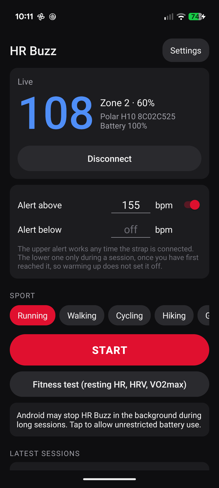
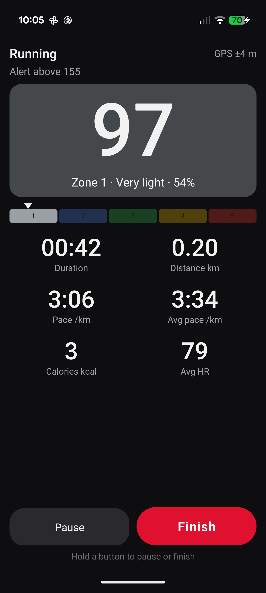
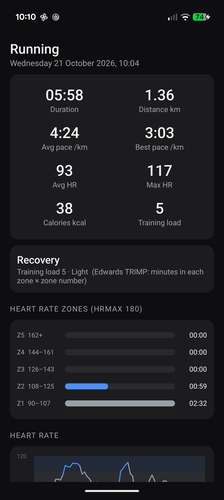
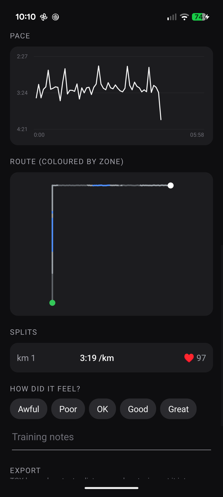

# HR Buzz

A ~120 KB Android app for a Bluetooth heart-rate strap (Polar H10, H9, Verity Sense, Garmin, Wahoo…) that does what Polar Beat does: records sessions with GPS, heart rate zones, calories and voice guidance. It also does what Beat can't: beeps and buzzes when your heart rate goes over (or under) a limit you set. One app instead of two. No account, no cloud, no ads, no analytics. The only network use is the optional coach (below), which is off until you set it up. Move minutes from Health Connect are optional too.

| Home | Training | Summary | Route & splits |
|---|---|---|---|
|  |  |  |  |

## Polar Beat parity

What Beat 3.5.13 does, and where it is here:

| Polar Beat | HR Buzz |
|---|---|
| Sport picker + Start | Running, Walking, Cycling, Hiking (GPS) and Gym, Other (no GPS) |
| Live HR, zone, duration, distance, pace, calories | Training screen: HR in zone colour with % of HRmax, zone pointer, duration, distance, current and average pace, calories, average HR |
| Voice guidance | Every km, or every 1 / 5 / 10 min: time, distance, pace, HR and zone. Ducks music |
| Walk break (running) | a button on the training screen: heart rate and GPS keep recording, the part is labelled for the coach, the low alert is off until you tap Back to running |
| Secure pause button | "Hold to pause or finish" (on by default) |
| Session summary: duration, HR avg/max, calories, distance, pace avg/max | Same, plus training load |
| HR and pace graphs, map | HR graph over zone bands, pace graph, route drawn to scale and coloured by zone (no map tiles: that would need the network) |
| How do you feel + training notes | Same |
| Latest sessions | Home screen list, newest first, a week at a time with each week's km, time and sessions; coached sessions are tagged |
| Fitness Test (OwnIndex) | Fitness test: 5 min lying still → resting HR, HRV (RMSSD, SDNN, pNN50) and a VO2max estimate, with history. "About these numbers" on that screen says how each is worked out and that none is validated against a reference ECG |
| HR sensor with battery | Strap name + battery %, remembered strap |
| Sync to Polar Flow | **Not done.** I couldn't find any way for a third-party app to upload to Flow. Export TCX/GPX instead (Strava, Garmin Connect, TrainingPeaks, Runalyze…) |
| Running Index, Training Benefit, EnergyPointer, fat-burn % | **Not copied**: they are Polar's own unpublished algorithms. Replaced by transparent equivalents: time in zones, Edwards TRIMP training load, and an effort label derived from where the time went |
| Save HR in the H10's memory | Not done: it needs Polar's proprietary protocol |

## Beyond Beat

- **Heart rate alarm**, the reason this app exists. By default it is *calm*: staying over the limit gets a short buzz (no sound) after 10 s, the beep and double buzz after 30 s, then every 10 s; 10 bpm over sounds at once, and a dip back under for a few seconds does not restart the clock. *Immediate* (Settings → Alarm) is the old rule: the beep after 3 readings in a row, repeated every 5 s. Either way there is 3 bpm hysteresis so it doesn't chatter. Works with or without a session running. Readings the strap flags as "no skin contact" are ignored. The default limit is 85% of your max heart rate.
- **Buzz-only cues.** Settings → Voice guidance → *Buzz only* says nothing aloud, so music and audiobooks are never interrupted: a workout step is one long buzz and then one short buzz for each step number, three long ones mark the end, and two short ones an announcement. *Voice* leaves out the step buzzes.
- **Coached announcements** tell the step, the time left and the heart rate against the step's target ("Step 2 of 3. 14 minutes left. Heart rate 118, in target."), and the training screen outlines the target range on the zone strip.
- **Jog and walk marks.** The button on a running screen marks walk breaks; on a walking screen it marks jogging stretches (a walk-jog session), so the coach can tell the parts apart.
- **Pause when standing still** (off by default, Settings → Training screen): with GPS, about 8 s without moving pauses the session and moving again resumes it; a pause you made stays.
- **Lower limit** (ZoneLock-style band). Only during a session, and only arms once you've reached it, so a warm-up doesn't set it off. Low tone and triple buzz.
- **Spoken alerts** ("Heart rate 158. Too high, ease off.") when voice guidance is on, at most every 30 s. The beeps keep going.
- **Lost-signal alarm.** If heart rate stops for 10 s after it had been coming in, a warbling tone and one long buzz (different from "too high") repeat every 5 s, with "Heart rate signal lost" spoken if voice is on and a chime when it's back. During a session it keeps going until the signal returns; outside one it stops after 30 s, so taking the strap off doesn't beep forever. The phone is kept awake while a session runs, because with the screen off Android otherwise delays the alarm timers.
- **Remembers your strap** and ignores every other one, so it never locks onto someone else's at the gym or a race. Forget it in Settings.
- **Skin contact warning** from the strap's contact flag ("wet the electrodes").
- **Strap battery** shown on the home screen, and on the training screen when ≤ 20%.
- **Auto-connect** when the app opens (like Beat), unless you last pressed Disconnect.
- **Km splits** with average HR per km.
- **Crash-proof recording.** Samples go to disk every second. If Android kills the app mid-run, the session is rebuilt from disk the next time the app starts.
- **Lock screen.** The training screen shows over the lock screen, and the notification (silent, but not "low", which Pixel hides there) shows live stats with Pause/Resume and Finish & save. Finish & save asks you to unlock first.
- **RR intervals** are recorded (in the session CSV) for later HRV analysis.
- **Battery prompt.** A one-tap request for unrestricted battery use, so Pixel battery management doesn't kill long runs.

## Coach (optional, your own AI key, or the model on your phone)

An LLM coach built to take as little effort as possible. It talks first, and you mostly tap:

- **Today's plan on the home screen.** "Easy run, 35 min", one line on why, its steps as zone-coloured bars, and the alerts it will set. **Start this run** sets everything up; **Not today / Shorter / Harder** re-plan in one tap. Rest days say so.
- **Guided workouts, offline.** Each step sets that step's alert limits for the session (never above your own "alert above" ceiling), chimes, and is spoken aloud, even with voice guidance off. The training screen shows the step, time left, the target band and % in target. The network is never needed mid-run.
- **Plan vs actual** on the summary of a coached session: each step's time done against planned, and how its heart rate split below, inside and above the step's target range. The debrief is given the same figures. The summary also puts a session's load against your usual one (the median of the last 4 weeks) in plain words.
- **Debrief** on the summary right after Finish: two or three lines with one concrete comparison to your history, and what's next. Older sessions and ones under 5 minutes get it on request, so browsing and false starts cost nothing.
- **Ask.** Suggestion chips that fit the day (before a run, after it, a rest day, a hard week), typing or speech. "Why this plan?" is read back from the plan with no request, and a plain question is answered without the reasoning pass (about 2 s instead of 10-20); a message that may change training still gets it. Answers that change today come back as an updated plan with **Start now** and **Undo**. "I can do 5 days now" updates the settings.
- **Morning notification** at your chosen time with today's plan and a Start button (a JobScheduler job, so it waits for a network and survives reboots). Sundays open with a one-line recap.
- **Setup is four taps** (goal, days a week, minutes, anything to work around), plus an optional target and date. It already knows your zones, profile and last 12 weeks.
- **Talk test.** Right after a session the summary (or a notification, from your pocket) asks whether you could talk in full sentences, short phrases or a few words. The debrief uses the answer, starts without it after 45 s, and is written again if it arrives later. The coach checks your zones against your answers, never the other way round: with no answer it says "by your current zones" and may ask about those sessions, with tappable answers under the debrief. Once three sessions say "full sentences", easy coached steps beep no lower than just above that heart rate (up to the top of zone 3, never above your own limit), and Settings says so. The zones themselves are not changed.
- **Morning check-in.** Two taps on the home card (how you slept, how your digestion is) and a link to the resting test while you haven't done one today; the morning notification has a **Resting test first** button. A test that shows you're tired softens today's plan on the phone, without calling the model.
- **Progress screen.** The same weekly figures the coach reads, on the phone: km, time, load and easy share per week, pace and metres per heartbeat against heart rate, how steady each session was, and the resting tests. "Am I improving?" opens it, and it can ask the coach what the numbers say. Plans show about how far they go at your usual pace.
- **Progress worked out on the phone.** Per week: km, median pace, heart rate and metres per heartbeat from the km splits, run pace at the same heart rate, and heart-rate drift within each run. The model reads trends instead of doing sums.
- **Max HR check.** The coach is told where your max HR came from, the age estimate and your highest recorded peak, and which long sessions averaged 88% of max or more. A habit of those usually means the max is set too low; the coach raises it once and asks how they felt.
- **Memory.** Lasting things you tell it in the chat (a preference, an injury, what training does for you) are kept, listed in the coach screen, and can be forgotten one by one. The coach also sees the last two weeks of what was planned, what you changed and what you did, and what it told you after each session.

- **Report this answer.** Under every coach reply in the chat and under each session debrief. Choosing a reason (wrong or unsafe advice, offensive, made up or not about training, something else) saves the report on the phone with the answer, what was asked and which service and model wrote it; the person is then offered an email to `privacy@sourdoughcalculator.uk`, written out in their own mail app for them to read, and nothing is sent until they press Send there. Coach settings lists how many are saved, and can email or delete them; "Delete everything the coach remembers" removes them too. Up to 50 are kept.

The model proposes; the phone decides. `CoachLogic.guard` checks every plan before it can run:

- It must be a valid shape. Sports and zones are clamped, and a session can be at most 4 hours (or your usual length while there are no recent sessions to build on).
- Readiness from your morning fitness tests caps it: resting HR up ≥ 8 bpm or HRV down 25% makes it easy, smaller rises soften the hard parts. Without a recent test, your watch's resting HR and HRV from Health Connect are compared with its own earlier days.
- There is no weekly volume cap; the coach judges a heavy week by recovery and intensity mix, not a percentage rise.
- Any mention of chest pain or tightness, arm or jaw pain, fainting, dizziness, palpitations, an irregular heartbeat or unusual breathlessness, in the chat or in a session's notes, never reaches the model. The phone answers "stop and see a doctor" and makes today a rest day (for 48 hours after a note like that).
- Step limits allow 5 bpm over the top of the zone. Zone-1-only steps (walks, cool-downs) keep only your own limit, and when a step lowers the limit you get 90 s to come down before it beeps.

Privacy, as shown in Coach settings:

- **Sent:** session totals (date, sport, time, distance, average/max HR, minutes per zone, km splits, load, feeling, talk test, notes) and trends computed from them, fitness-test resting HR/HRV/VO2max, check-ins, the plan's two-week history, what the coach keeps in mind, Health Connect daily totals if on, and age, sex, weight, max HR (and its source) and your setup answers.
- **Never sent:** GPS or location, second-by-second HR, RR data, your name.
- **Your key:** stored encrypted with an Android keystore key and only sent to the service it belongs to (`api.openai.com`, `api.anthropic.com`, `generativelanguage.googleapis.com` or `api.deepseek.com`) over HTTPS (cleartext is disabled app-wide).
- **Controls:** *See the last message sent* shows the exact request. *Delete everything the coach remembers* wipes the plan and its history, the conversation, what it keeps in mind, the check-ins, the request log and the debriefs.

**Bring your own key.** Paste an API key from OpenAI (ChatGPT), Claude, Gemini or DeepSeek and the app works out the rest: the key's shape says which service it is (`sk-ant-` Claude, `AIza` Gemini, `sk-` plus 32 hex digits DeepSeek, any other `sk-` OpenAI; where an `sk-` key could be two, both are asked), the service's own model list says what the key can reach, and the newest model of the small tier is chosen (a Haiku, a "luna" or "mini", a "flash"; DeepSeek keeps `deepseek-flash`), the tier the coach was built on. That is about 30 cents to a few dollars a month at the app's usual four or five requests a day (measured at about 42,000 input and 11,500 output tokens a day); `store/api-keys.md`, published at https://hrbuzz.sourdoughcalculator.uk/keys/, has the per-service figures and how to get each key. Each service then gets its own request: JSON mode where there is one and a JSON-only instruction where there is not, and the service's own "think first" setting for the reasoning pass (OpenAI `reasoning_effort`, Claude adaptive thinking with `effort`, Gemini `thinkingConfig`, DeepSeek `thinking`). If a model refuses an optional setting, the request is repeated with fewer of them, so a model released later still works; if a chosen model disappears, the next request picks again. Coach settings shows the service and model in use, and "See the last message sent" shows the exact request.

**Getting the key onto the phone.** The service chips in Coach settings open each service's key page. Coming back with a key on the clipboard offers "Use the key you just copied?" with one button (the clipboard is read only on that return, and Android tells the person each time an app reads it), and "Paste from clipboard" does the same on demand. A key is checked with the service before it is saved, so a typo never replaces a working key, and a key taken from the clipboard is wiped from it once used. Someone who creates the key on a computer can send it to the phone by any means (a message to themselves, Chrome's send-to-device, a notes app), copy it there, and the same offer appears.

**Or no key: the model on the phone.** In the `ondevice/` build (below), Coach settings also offers "Use the coach on this phone": Gemma 4 E4B from the AICore developer preview, run by Android itself through Google's ML Kit GenAI Prompt API. Free, and nothing leaves the phone. It is a preview model, so it exists only on a Pixel enrolled in the AICore developer preview (the Play build has no engine and hides the option). `OnDevice.java` is the plain-Java side (engine interface, error wording, the JSON retry); `ondevice/.../MlKitEngine.kt` is the engine, found by name at runtime. What was measured on a Pixel 10 Pro XL with the app's real 5,600-token plan prompt, thinking off:

- A plan takes about 30 seconds, a chat answer 12 to 14. Valid JSON in the coach's shape on every run (plans, plain questions, "swap today for 30 minutes"). The smaller E2B model is 2.5 times faster but rewrites today's plan on a plain question, so it is not used.
- Thinking mode is not used: it made a plan 3 to 4 times slower (100 to 114 s) without a better one.
- **AICore refuses background use.** A plain background job and a foreground service with a notification were both refused (`GenAiException` code 30, "Background usage is blocked") within a second, with the screen on; a request already running when the app is sent away finishes. So the on-device coach answers, plans and debriefs only while HR Buzz is on screen: opening the app on a day with no plan plans it, and the morning job posts "Ready to plan today" instead of calling the model. Other refusals are worded for the person: busy (9), the battery quota (27), AICore needs an update (604), no storage (501).
- A small model reads dates and numbers badly: it called a Friday a Thursday, and after six days off it wrote "a gentle recovery day after your recent hard efforts" in 4 of 4 plan trials, although the facts were in the brief as a number deep in the JSON. So the phone now says it in words. `CoachLogic.situation` puts plain sentences first in the brief, right after the date ("Their last session was Fri 2026-10-23, 6 days ago.", "5 of the days planned since then had no session recorded.", "Their last hard effort ... was 7 days ago: they have not trained hard since.", and after a break of 3 days or more "Say so in the message: do not describe them as freshly hard-trained or needing recovery from efforts that are days old."), repeats them as a "Before you write" line at the very end of the plan request, gives each recent session a `daysAgo`, and adds a weekday `day` beside the dates of the plan history and the week outline. Measured on the phone with the real prompt: the wrong "recovery from recent hard efforts" reading went from 4 of 4 plans to 0 of 4 with the facts first, and to 0 of 3 in the app itself, which also has the reminder line; the plan acknowledged the break in 4 of 4 lab trials and 2 of 3 in the app (the third just said "keep the momentum going"). The lab test of the reminder alone used a prompt with the line in the wrong place, so only the in-app figures count for it. The plans after a break are shorter too (35 to 40 minutes against 60 to 70), which a six-day gap makes defensible but is well under a 12 to 15 km a day habit. Telling the model more did not change that: with the goal text ("12-15 km most days"), the 120-minute setting and even a remembered "normal day is 12-15 km" in the prompt, today's plan stayed at 35 to 60 minutes, and adding a rule to ease back toward the usual session only made it say it was building back to it, so that was not kept. Every service gets these facts, not only the on-device model.

There is no "sign in with your ChatGPT / Claude / Gemini account": those subscriptions cover the companies' own apps, other apps use API keys billed by use, and Anthropic's terms do not allow third-party apps to sign in with a Claude account. The coach makes a handful of requests a day. Settings has links to each service's key page.

The model is called only at four moments: the morning plan, after Finish, Sunday, and when you ask.

## Move minutes (optional, Health Connect)

Settings → Activity → **Move minutes** reads your steps and workouts from Health Connect, where Google Fit, Fitbit, Pixel Watch and most fitness apps save them, and counts the minutes you were moving. It shows on the home screen (today, and the last 7 days against the 150 min a week guideline) and the coach is told the daily totals, so it knows how sedentary or active you are between sessions.

- **Not Google Fit.** The Fit APIs are being shut down and have no replacement for apps without a server; Health Connect is the on-device successor. Android 14 or newer (it is part of the system there, so no library is added).
- **Our own count.** Fit's "Move Minutes" has no Health Connect equivalent, so a minute counts when it has at least 50 steps or falls inside a workout (HR Buzz's own sessions count too). Steps written by two devices for the same walk are not added together. It will be close to what Fit showed, not identical.
- **Sleep, distance and heart data.** If you also allow them, the last 14 days of sleep (hours, when you fell asleep and woke), steps, km, resting heart rate and HRV are read for the coach. Steps and workouts are all move minutes need; the rest is optional (Settings → Activity → *Allow sleep, distance and heart data*).
- **Read-only.** Nothing is written to Health Connect. Health Connect only allows reading while the app is open, so the data is refreshed when you open HR Buzz and the morning plan uses the last read.
- **Privacy.** On the phone, plus, if the coach is on, the daily totals sent to the coach's AI service (never the records, times or workouts behind them). Turning it off forgets them.

## Zones and calories

Zones are Polar's default five: 50–60–70–80–90–100% of HRmax. HRmax is the value you enter in Settings, or Auto: 220 − age (Polar's default), raised to the highest heart rate you've held for 10 s in a session, once you agree. A new peak is never used without asking, because a strap glitch can read high. Zones are only as good as that number, so enter your real maximum if you know it. If you take beta-blockers or have a heart condition, use the limit your doctor gave you; the first-run screen asks for it.

Calories use the heart-rate formula of Keytel et al. (2005), so set age, sex and weight (the app asks on first run). Keytel comes from exercise and runs high at easy heart rates, so below 45% of HRmax a light-activity estimate (2.5 MET) is used instead, blending into Keytel by 60%. The fitness test's VO2max is Uth et al. (2004), 15.3 × HRmax / resting HR. It's an estimate, not a lab test.

## Verified on device

Pixel 10 Pro XL (Android 17) with a real Polar H10:

| Check | Result |
|---|---|
| Connect, live HR, strap name, battery | 68 bpm, "Polar H10 8C02C525", 100% |
| Auto-connect on app launch | live within ~5 s |
| Over-limit alarm, home + training screen | red number / red HR card, tone + buzz, spoken alert |
| Session record, pause, resume, finish (long press) | saved, summary opens |
| Voice guidance every 1 min and every km | spoke on the minute and at 1.00 km |
| GPS distance, pace, km split, route (fed by a test GPS provider at 5 m/s) | 1.36 km, split 3:19 /km (5 m/s = 3:20), route drawn |
| App killed mid-session (reinstall) | session recovered from disk |
| Share TCX | share sheet with `hrbuzz_2026-10-21_1001_running.tcx` |
| Fitness test start / cancel | countdown runs, cancel resets |
| Lost signal in a Gym session, unplugged, screen off, strap taken off | 30 of 30 alerts on time (5.1 s apart) over 2.5 min, "back" chime when the strap went back on. Before the wake lock: 23 of ~44, gaps up to 19 s |
| Lost signal outside a session | 6 alerts over 30 s, then quiet; wake lock held only for those 30 s |
| Strap connected but not worn | no alarm (previously a buzz every 14 s) |
| Alarm vibration strength | full (alarm usage); previously 51%, scaled as media |

Not yet tested outdoors with real GPS; the distance filter (accuracy ≤ 25 m, jumps > 30 m/s dropped, steps smaller than the fix noise held back) is tuned from the usual phone-GPS behaviour.

## Install

The prebuilt APK is `hr-buzz.apk` (not committed; `./build.sh` makes it).

```bash
adb install -r hr-buzz.apk
```

On first launch it asks for **Nearby devices** (Bluetooth) and **Notifications**. **Location** is asked for the first time you start a GPS sport. Without it, sessions record heart rate only.

## Use

1. Put the strap on (wet the electrodes).
2. Open HR Buzz. It finds the strap by itself.
3. Set **Alert above** (and optionally **Alert below**).
4. Pick a sport, press **Start**. Pocket the phone.
5. Hold **Finish** (or tap **Finish & save** in the notification). The summary opens, where you can rate it, add notes or share TCX/GPX.

The first time, open **Settings** and enter age, sex, weight and (ideally) your real max HR.

You can still run Polar Beat or Strava alongside it: an H10 with "2 Bluetooth connections" enabled serves both.

## Build

No Gradle, no Android Studio, no AndroidX. The builds (apart from the optional `ondevice/` one below) are shell scripts over the SDK tools:

```bash
./test.sh                     # plain-JVM tests: decode, alarm, zones, calories, stats, splits, export, AI services, reports
DEBUG_BUILD=1 ./build.sh      # -> hr-buzz.apk: debuggable (adb run-as), signed with a local debug key; for the phone on your desk
./build.sh                    # -> hr-buzz-release.apk and hr-buzz-release.aab: never debuggable, signed with the upload key
DEBUG_BUILD=1 ./build-wear.sh # the watch app, same two modes (hr-buzz-wear.apk, hr-buzz-wear-release.apk/.aab)
VERSION_CODE=6 VERSION_NAME=2.4 ./build.sh   # Play needs a higher version code for every upload
```

**On-device build.** `ondevice/build.sh` (add `install` to also run `adb install`) makes `hr-buzz-ondevice.apk`: the same `src/` and `res/` built by Gradle (AGP 9.2.1, Kotlin 2.4.0, Gradle 9) together with the ML Kit GenAI library (`com.google.mlkit:genai-prompt:1.0.0-beta5`) and `MlKitEngine.kt`. Gradle is only there because the library brings a manifest merge, Play-services and Kotlin dependencies that the shell build cannot do. It is a debug build signed with the same local debug key as `DEBUG_BUILD=1 ./build.sh`, so it installs over that one and keeps its data, and it is 13 MB against 200 KB. The release and Play builds stay on `build.sh` and have no on-device coach: before shipping it, the Data safety form, the privacy policy and the AI-generated content answer need a line saying the on-device coach sends nothing, and the model has to be generally available (today it is a developer preview).

Requires `ANDROID_HOME` (defaults to `/opt/android-sdk`) and a JDK (`JAVA_HOME`, defaults to `~/.cache/polar-hr-toolchain/jdk`). compileSdk 37, minSdk 31 (watch 34), targetSdk 37.

**Release signing.** Run `./make-upload-key.sh` once: it makes the Play upload key in `~/.config/hrbuzz-signing/` (outside the repo and outside `~/.cache`). Back that folder up somewhere off the machine; if it is lost, Play support has to reset the upload key. Release builds refuse to run without it, and refuse to keep a build that turns out debuggable.

**Bundles.** The `.aab` step needs bundletool: either a `bundletool-all-*.jar` saved as `~/.cache/polar-hr-toolchain/bundletool.jar`, or a launcher script `bundletool` beside it that runs the jars Gradle has already downloaded into `~/.gradle` (bundletool 1.18.3 with Guava 32.0.1-jre; the Android flavour of Guava crashes it). Without either, a release build makes the APK only and says so.

## Layout

| Path | What |
|---|---|
| `src/.../HrLogic.java` | Heart rate payload decode (HR, contact, RR) and the high/low alarm state machine. Pure Java, tested |
| `src/.../Training.java` | Zones, Keytel calories, haversine, session stats, splits, TRIMP, effort label, RMSSD, formatting, CSV sample format. Pure Java, tested |
| `src/.../Move.java` | Move minutes from step intervals and workouts, per local day, and the sedentary / active label. Pure Java, tested |
| `src/.../HealthSync.java` | Reads steps and workouts from Health Connect (framework API) and caches the week |
| `src/.../Export.java` | TCX and GPX writers. Pure Java, tested |
| `src/.../HrManager.java` | BLE scan/connect/notify, strap pinning, battery, tone + vibration |
| `src/.../Recorder.java` | Session recording: 1 Hz samples to disk, GPS distance filter, voice guidance |
| `src/.../SessionStore.java` | Sessions on disk (`files/sessions/<id>.csv` + `.json`), crash recovery, export files |
| `src/.../LiveService.java` | Foreground service (connected device + location) and the live notification |
| `src/.../ExportProvider.java` | Minimal read-only content provider for sharing exports |
| `src/.../MainActivity.java` | Home: strap, live HR, alert limits, sport, Start, latest sessions |
| `src/.../TrainingActivity.java` | Live training screen |
| `src/.../SummaryActivity.java` | Session summary, charts, route, splits, notes, export, delete |
| `src/.../SettingsActivity.java` | Profile, zones, voice, training screen, alarm test, strap, battery |
| `src/.../FitnessTestActivity.java` | Resting HR / HRV / VO2max test |
| `src/.../LineChartView.java`, `ZoneBarsView.java`, `ZoneStripView.java`, `RouteView.java` | Hand-drawn charts |
| `src/.../Json.java` | Small JSON reader/writer, so the coach logic runs on a plain JVM |
| `src/.../CoachLogic.java` | Coach brain on the phone: what the model sees, prompts, reading answers, plan checks, readiness, red flags, step limits. Pure Java, tested |
| `src/.../Provider.java` | The four AI services: key recognition, endpoints, request and reply shapes, model choice, error wording. Pure Java |
| `src/.../Llm.java` | The client over `Provider` (java.net, retry on empty, fewer settings when one is refused, key check). Tested against local stub servers |
| `src/.../OnDevice.java` | The coach's on-device path: the engine interface, finding the engine by name, JSON retry, error wording. Pure Java, tested with a fake engine |
| `ondevice/` | The optional Gradle build with the ML Kit engine (`app/src/main/kotlin/.../MlKitEngine.kt`) and `build.sh` |
| `src/.../Coach.java` | Coach on Android: settings, encrypted key or the on-device switch, plan, conversation, morning job scheduling |
| `src/.../CoachJob.java` | Morning plan job + notification ("Ready to plan today" when the coach is on-device) |
| `src/.../CoachActivity.java`, `CoachSetupActivity.java` | Coach screen (week, next days, conversation) and setup/privacy |
| `test/...` | `HrLogicTest`, `TrainingTest`, `CoachTest`, `LlmTest`, `OnDeviceTest`, `ReportsTest`, `ImportTest`, `MoveTest`, `WearLogicTest` |

## Known limits

- An H10 that isn't being worn doesn't advertise, so the app will sit on "Searching…". Wet the strap.
- The route has no map underneath. Share the GPX to see it on one.
- Calories, zones and VO2max are only as good as the profile in Settings.
- It's a training aid, not a medical device.
